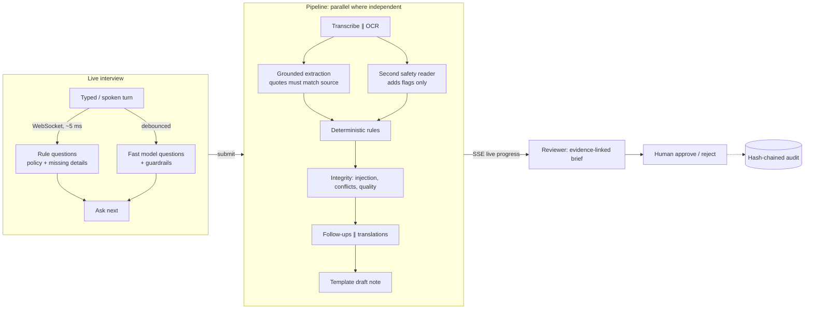

# CareFlow AI

**Speak in any language. Every sentence has a receipt.**

CareFlow AI is a voice-first, multilingual intake and review system for busy clinics. A **live interview copilot**
suggests the next question while the patient is still talking, in Hindi, Hinglish or English. Clinicians then get an
**evidence-linked brief** in which every extracted claim points back to the exact words, audio second or report page
it came from.

> **Synthetic data only. Not for clinical use.** CareFlow AI does not diagnose, recommend treatment or make care
> decisions. Its warning-sign rules are not clinically validated. A human reviewer makes every decision.

## The problem

In outpatient clinics across India, intake staff collect symptoms in a mix of languages. They do it under time
pressure, often by voice, and with no guidance on what to ask. Clinicians then receive long, unstructured notes. Missing
details (onset, severity, medicines, allergies) surface only during the consultation, and warning signs can sit
unnoticed in a queue.

## What CareFlow AI does

| Moment | What happens |
|---|---|
| **1. Live interview** | The intake worker types or records what the patient says. The copilot updates **while they type** (about 5 ms round trip) with the next best question. Each question is shown in the patient's language with English underneath. |
| **2. Warning signs first** | If something like breathing difficulty is mentioned, a red banner appears and the clarifying question from the **clinician-editable policy** comes first. |
| **3. AI adds depth** | About 0.4 s later, a fast model suggests questions the rules can't think of, such as related symptoms or triggers. Guardrails block anything that diagnoses, advises or reassures. |
| **4. Live brief** | A completeness ring and symptom chips show what has been captured and what is still missing, so the worker knows when the interview is done. |
| **5. Evidence-linked review** | Reviewers see the original sources beside the brief. Hovering any symptom highlights its source span, and clicking an audio quote plays that second. Interview questions appear inline above the answers they produced. |
| **6. "Why this tier?"** | One click shows exactly which rule matched which words, whether a model added anything, and any reviewer override. The system tier stays visible. |
| **7. Human decision** | Approval requires a human note and every flag resolved with a reason. The AI draft stays separate and read-only. Everything is written to a hash-chained audit log. |

## Architecture



Design choices worth knowing:

- **Rules decide, models assist.** Deterministic rules in a YAML policy set the tier. Models may add flags but can never remove one or lower the tier. A case that couldn't be assessed is "Undetermined", never "Standard".
- **Grounded extraction.** Every symptom and fact must quote the source exactly. Items whose quote can't be found are dropped and flagged.
- **Questions are metadata, never screened text.** An interview answer stores the question it answered. Rules screen only what the patient said, and extraction uses the question to interpret answers like a bare "No".
- **It keeps working without AI.** With no provider key, the copilot runs in rules-only mode and the pipeline fails closed: the rules still run, and failures are flagged.
- **Reliable demos.** `SEED_DEMO=on` loads synthetic cases on an empty database, and `LLM_CACHE=auto` replays identical provider calls.

## Run locally

Backend (Python 3.11+):

```bash
cd backend
python3 -m venv .venv && source .venv/bin/activate
pip install -r requirements.txt
cp .env.example .env   # add GROQ_API_KEY / OPENROUTER_API_KEY (optional: rules-only works without them)
uvicorn app.main:app --reload
```

Frontend (Node 18+):

```bash
cd frontend
npm install
npm run dev
```

Open http://localhost:5173. The API runs at http://127.0.0.1:8000 (docs at `/docs`).

### Demo accounts

Password `careflow-demo` (change it with `DEMO_PASSWORD`). The sign-in page also has one-click role buttons.

| Account | Role | Can do |
|---|---|---|
| intake1 | Intake | Live interviews; sees operational status only after submission |
| reviewer1, reviewer2 | Reviewer | Queue, evidence-linked brief, flags, notes, decisions, ops, trust pages |
| admin1 | Admin | Everything above, plus the audit log and hash-chain verification |

## Deploy: Render (API) + Vercel (web)

1. **Render:** create a Blueprint from this repo; it reads `render.yaml`. Set `GROQ_API_KEY`, `OPENROUTER_API_KEY`, `DEMO_PASSWORD`, `CORS_ORIGINS` (your Vercel URL) and optionally `CORS_ORIGIN_REGEX` (for Vercel previews).
2. **Vercel:** import the repo with **Root Directory `frontend`**. Set `VITE_API_BASE_URL` to the Render URL and deploy. `frontend/vercel.json` handles SPA routing and caching.
3. **Free-tier notes:**
   - Render free instances sleep when idle. The UI polls `/health` and shows a "waking up" banner instead of failing.
   - The disk is ephemeral. `SEED_DEMO=on` re-creates the synthetic demo cases, and interrupted cases resume on boot.
   - Open the app a minute before presenting.

## Verify

```bash
cd backend && python -m unittest discover -s tests -t .   # 69 tests, mocked models
python ../eval/run_eval.py                                 # offline rule benchmark (116 synthetic cases)
python ../eval/run_slm_eval.py                             # live extraction check; needs provider keys
```

The **Trust & safety** page runs the rule benchmark live inside the app. Reviewers and admins can open it, and
admins can also verify the audit hash chain there.

**What has been verified:**
- The automated tests cover the copilot rules and guardrails, interview sessions, the WebSocket flow, submission into the pipeline, seeding, metrics, roles, consent, the review flow and the audit chain.
- The end-to-end browser walkthrough was run against the production build: sign-in, the live interview (rules plus a stubbed model endpoint), queue, case brief, ops, trust, dark mode and mobile sign-in.

**Not verified in that walkthrough:**
- Live provider calls (Groq / OpenRouter).
- Microphone capture on real devices.
- Report OCR quality.
- Translation quality.

Run a full synthetic workflow with your keys before presenting. The recorder warns when a recording contains no
sound (a known Firefox issue on some devices).

## Repository layout

```text
backend/   FastAPI API: interview copilot (app/copilot), pipeline, safety rules, SSE/metrics, tests
frontend/  React + TypeScript + Vite + Tailwind app
eval/      Synthetic rule benchmark and live extraction check
samples/   Synthetic text and audio inputs
docs/      Architecture, demo script, assumptions, test-case PDFs
```

See [docs/demo-script.md](docs/demo-script.md) for a 3-minute judging walkthrough and
[docs/architecture.md](docs/architecture.md) for details.
